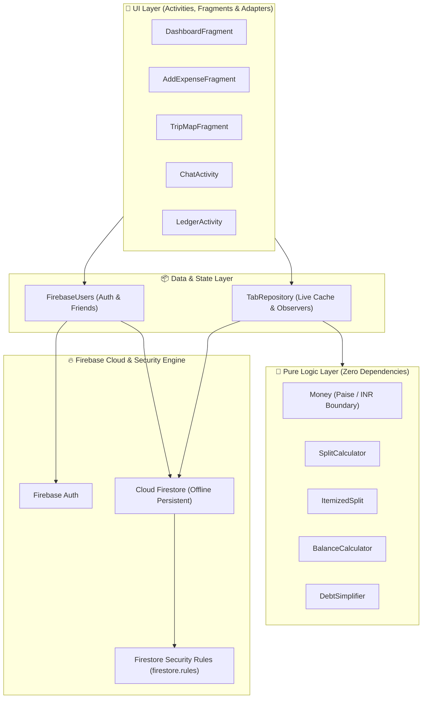

# 💳 TABABLE - Smart Expense Splitting & Shared Ledger

[](https://developer.android.com)
[](https://www.oracle.com/java/)
[](https://developer.android.com/topic/architecture)
[](https://firebase.google.com/)
[](https://developers.google.com/maps)

**TABABLE** is an Android application designed for friends, room-mates, and travel groups to share expenses, track balances in real time, settle debts, and chat in shared spaces.

Built natively for Android with **Java**, **Firebase Cloud Firestore**, and **Google Maps API**, TABABLE showcases real-time data synchronization with an offline-first repository pattern and strict zero-trust Firestore security rules.

---

## 🍕 The Concept (Or: How Not to Lose Friends Over Samosas)

We’ve all been there:
1. You go out for dinner with 5 friends.
2. One person orders a simple salad, someone else orders 4 Butter Naans and a fancy mocktail, and another person claims *"I’m not hungry, I’ll just eat off your plate."*
3. The bill arrives, and suddenly everyone becomes an amateur accountant trying to solve a 5th-degree differential equation on their phone calculator at 11:45 PM.
4. By 1 AM, the WhatsApp group chat is in full meltdown over ₹47 owed for an auto-rickshaw ride.

Enter **TABABLE** — your group's zero-drama financial peacekeeper. 🕊️

### 🎭 Why TABABLE Exists:
- **No More "I'll Pay You Back Later" Amnesia**: Every coffee, cab ride, and late-night pizza is logged in real time into shared 1-on-1 or group spaces.
- **The "I Didn't Eat That" Itemized Split**: Why should you pay for someone else's triple-shot caramel macchiato when you had tap water? Itemized splitting divides each line item *only* among the people who actually consumed it.
- **No Self-Declared Payments ("Bro, trust me I sent it")**: Payers can mark a settlement as *Proposed*, but the balance doesn't move an inch until the payee hits *Confirmed*. No ghost UPI screenshots allowed!
- **Interactive Expense Mapping**: Geotag your expenses on a map so you can visually track the exact location where your bank account took a hit during a weekend trip.
- **Sub-Paisa Precision Engine**: Because even floating-point rounding errors (`0.1 + 0.2 = 0.30000000000000004`) shouldn't get to ruin a friendship!

---

## 🌟 Key Features

- 💸 **Flexible Expense Splitting**:
  - **Equal Split**: Evenly distribute costs among all participants.
  - **Custom Split**: Manually set custom split amounts per person.
  - **Itemized Receipt Split**: Assign individual bill items to specific people with exact sub-paisa precision (no penny loss).
- 🤝 **Direct & Group Spaces**:
  - **1-on-1 Direct Tabs**: Auto-managed 1-to-1 tab spaces for pairs of friends.
  - **Group Spaces**: Multi-participant spaces for trips, households, and events.
- 💬 **In-App Real-Time Messaging**:
  - Direct chat within spaces with live Firestore updates, integrated transaction notifications, and balance change history.
- 🗺️ **Location-Aware Trip Mapping**:
  - Geotag expenses with Google Maps place pickers or GeoJSON spatial data (`chandigarh_places.geojson`).
  - View spent locations on an interactive map using `TripMapFragment`.
- 🔐 **Payee-Confirmed Settlements & Zero-Trust Security**:
  - Two-way verification: Payers submit proposed settlements, but balances only update when the **payee confirms** receipt.
  - Comprehensive Firestore Security Rules guarantee user profile privacy, prevent forged friendships, and block unauthorized data access.
- ⚡ **Offline-First Durability**:
  - Local disk persistence enables seamless reading and writing while offline. Reconnecting automatically syncs pending actions with the backend.
- 📊 **Debt Simplification Engine**:
  - Integrated `DebtSimplifier` and `BalanceCalculator` minimize the net transaction graph across group members.

---

## 🏗️ System Architecture

TABABLE employs a strict three-layer architecture with a single-direction data flow: **UI Layer ➔ Repository Layer ➔ Firebase Backend**.



### Pure Logic Isolation
The core financial domain models inside `com.example.tab_able.logic` (`Money`, `SplitCalculator`, `ItemizedSplit`, `BalanceCalculator`, `DebtSimplifier`) contain **zero** Android or Firebase SDK dependencies. This makes the money calculation engine 100% unit-testable on the JVM in milliseconds.

---

## 🔐 Security & Data Model

All authorization logic is strictly enforced by server-side [firestore.rules](firestore.rules). Client-side checks are advisory only.

### Key Security Guarantees
1. **Private User Profiles**: Profiles cannot be listed or scraped by unauthorized users. Profiles are accessible only by confirmed friends or accounts with pending friend requests.
2. **Forged Friendship Prevention**: A friendship document can only be created if an `ACCEPTED` friend request document exists.
3. **Payee-Only Confirmation**: A payer can record a settlement (`PENDING`), but only the designated payee can update its status to `CONFIRMED`.
4. **Member-Only Space Access**: Spaces, messages, expenses, and settlements can only be read/written by verified space members.

### Schema Overview

```
users/{uid}                              -> User Profile (email, displayName, username)
users/{uid}/friends/{friendUid}          -> Edge document (stores friend name snapshot)
friendRequests/{senderUid}_{recipientUid}-> Friend request handshake
emailLookup/{emailLower}                 -> Unique email registration lookup
usernames/{usernameLower}                -> Unique username lookup
spaces/{spaceId}                         -> Direct or Group Space metadata
spaces/{spaceId}/expenses/{id}           -> Expense records, items, paidBy, shares (in paise)
spaces/{spaceId}/messages/{id}           -> Real-time messages & system logs
spaces/{spaceId}/settlements/{id}        -> Payment proposals & confirmations
```

---

## 📁 Project Structure

```
com.example.tab_able
 ├── adapters/             # RecyclerView Adapters (People, Group, Ledger, Activity)
 ├── data/                 # Models, TabRepository & FirebaseUsers manager
 ├── fragments/            # Dashboard, AddExpense, Groups, TripMap, ProfileExport
 ├── logic/                # Pure Java money arithmetic, splitting & debt algorithms
 ├── views/                # LocationPickerDialog & custom dialog components
 ├── AddFriendsActivity    # User search & friend request management
 ├── ChatActivity          # Real-time space chat & transaction feed
 ├── LedgerActivity        # Detailed balance history & settlement view
 ├── LoginActivity         # Auth entry point
 ├── MainActivity          # Bottom navigation host
 ├── RegisterActivity      # Account creation & unique username setup
 └── TabApp                # Application class initializing Firestore persistence
```

---

## 🛠️ Tech Stack & Specifications

- **Platform**: Android SDK (Min API 24, Target API 36)
- **Language**: Java 17
- **Architecture**: Repository Pattern, Single Source of Truth
- **UI Framework**: XML Layouts, Material Design 3 components, `AppCompatActivity`, `Fragment`
- **Backend**: Firebase Auth, Cloud Firestore (`firebase-bom:33.7.0`)
- **Maps**: Google Maps SDK (`play-services-maps:18.2.0`)
- **Build System**: Gradle KTS with Version Catalog (`gradle/libs.versions.toml`)

---

## 🧪 Testing & Validation Architecture

The domain and math engine is validated by an isolated suite of unit tests focusing on financial correctness:

| Test Suite | Purpose & Coverage |
| :--- | :--- |
| **`MoneyTest`** | Validates paise/rupee boundary conversion, strict currency parsing (`Money.parsePaise`), and INR formatting (`₹`). |
| **`ItemizedSplitTest`** | Tests per-item bill splitting, sub-paisa remainder distribution, and unassigned item detection. |
| **`LogicTest`** | Covers balance calculations, settlements, and geospatial coordinate calculations. |

---

## 💡 Key Engineering Highlights

### Paise Internal Boundary
To eliminate floating-point precision errors (e.g. `0.1 + 0.2 != 0.3`), all financial amounts in Firestore and calculation logic are stored strictly as **Paise** (`long` integer). Conversion to **Rupees** (`₹`) occurs strictly at the UI display boundary via `Money.formatInr()`.

### Symmetrical Document IDs
- **1-on-1 Spaces**: Keyed using sorted UIDs (`{smallerUid}_{largerUid}`) so both participants independently land in the exact same space without handshake overhead.
- **Friend Requests**: Keyed using sender and recipient UIDs (`{senderUid}_{recipientUid}`) with Firestore Security Rules configured to accept symmetric evaluations.

---

## 📄 License

This project is licensed under the [MIT License](LICENSE) - see the LICENSE file for details.
